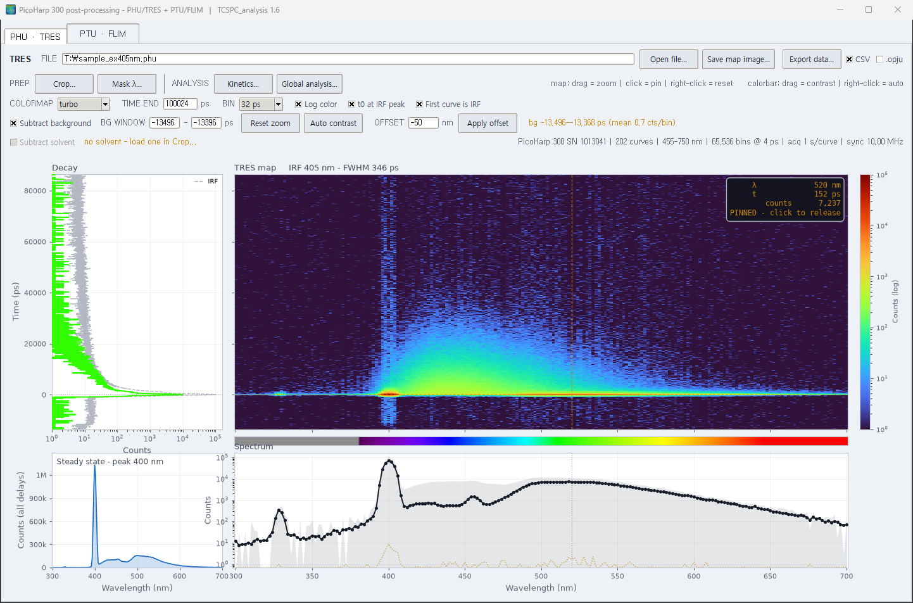
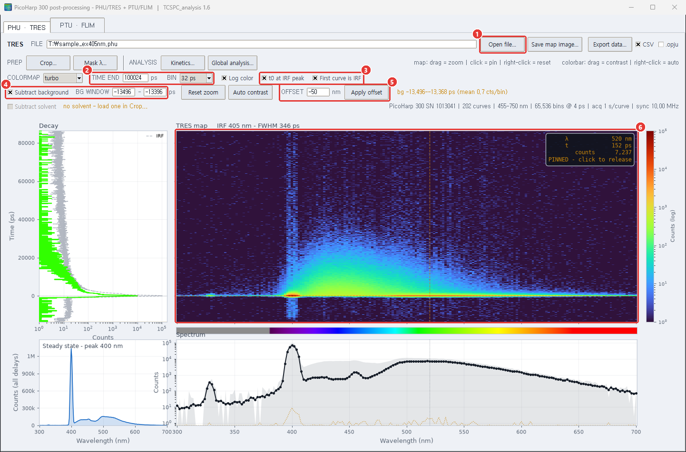
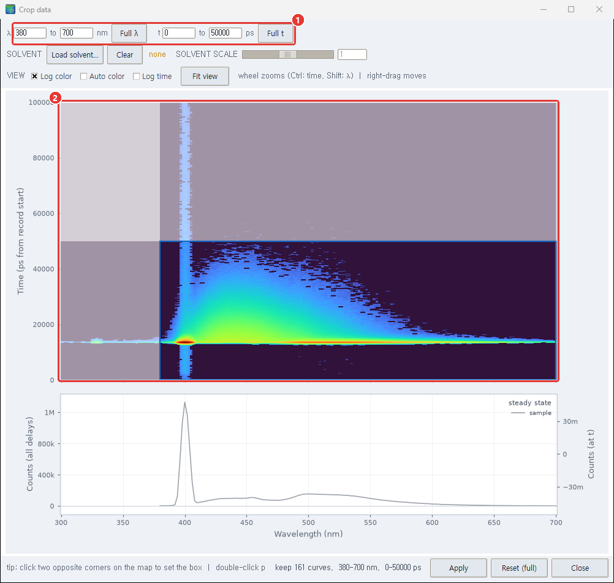
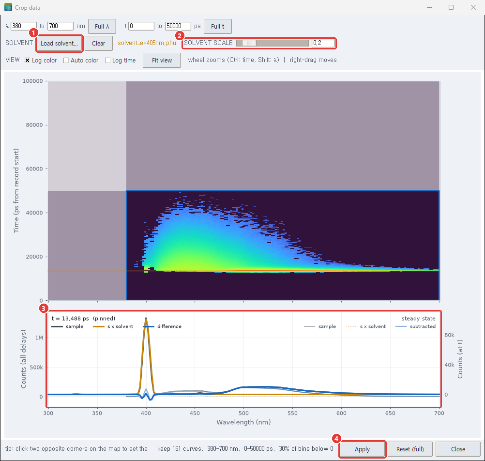
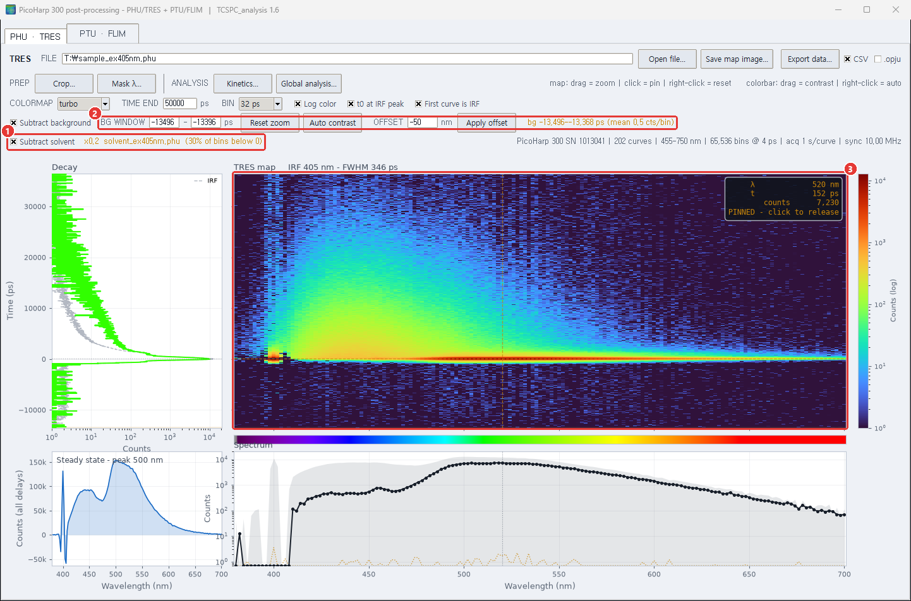
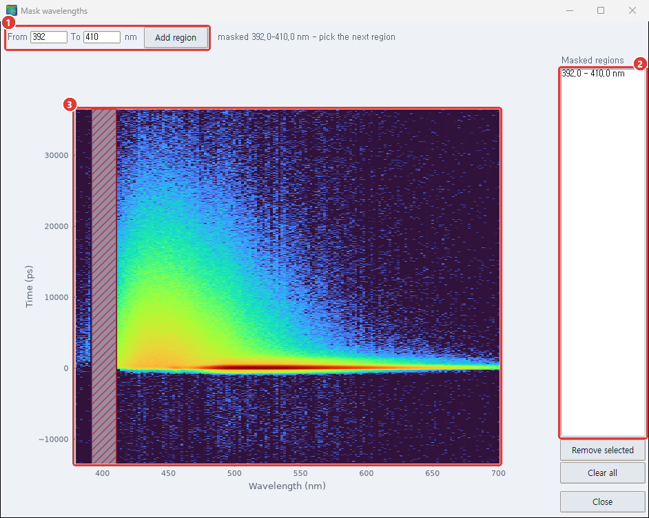
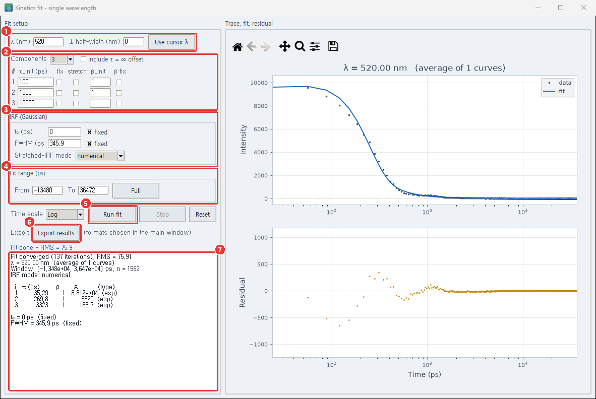
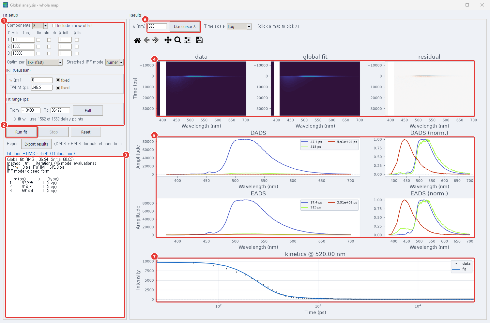
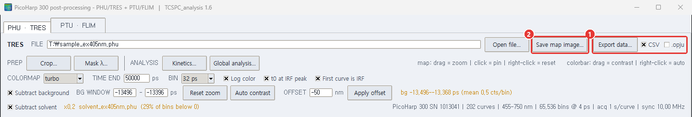

# tres_analyzer

[한국어](README.md) | **English**

A Windows GUI program for post-processing PicoQuant PicoHarp 300 TCSPC measurements. It handles `.phu` files (TRES: time-resolved emission per wavelength) and `.ptu` files (FLIM) in two tabs of one window.

- View the TRES map (wavelength × time) and the steady-state spectrum, subtract the background, calibrate the wavelength axis
- Cut a wavelength / time range (Crop), subtract a solvent measurement, hide wavelength bands (Mask)
- Fit the decay at one wavelength (Kinetics) or the whole map at once (Global analysis, DADS / EADS)
- Export to CSV and to Origin `.opju`

The latest version is **1.6**. What changed in each version is in the [version table below](#versions) and in [CHANGELOG.md](CHANGELOG.md) (in Korean).

## Contents

- [Installation](#installation)
- [Walkthrough: a sample and a solvent measurement](#walkthrough-a-sample-and-a-solvent-measurement)
- [Mouse and keys](#mouse-and-keys)
- [FAQ](#faq)
- [Glossary](#glossary)
- [If the program hangs](#if-the-program-hangs)
- [PTU · FLIM tab](#ptu--flim-tab)
- [Versions](#versions)
- [License](#license)

## Installation

There are two ways. If you do not use Python, take the **executable**.

### Option 1. Executable (no Python needed)

1. Download `TCSPC_analysis_1.6.zip` of the latest version from the [Releases](https://github.com/Myungsam/tres_analyzer/releases) page.
2. Before extracting, right-click the zip → **Properties** → tick **Unblock** at the bottom → OK. Otherwise Windows marks every extracted file as downloaded from the internet and checks each one on the first start.
3. Right-click the zip and choose **Extract All**. Extract it to a **local folder that is not synced by OneDrive or similar** (e.g. `C:\Programs`). The zip holds a `TCSPC_analysis` folder, so this example gives `C:\Programs\TCSPC_analysis\TCSPC_analysis.exe`. In a synced folder the many files slow the sync down, and the program can start slowly while the files are fetched.
4. Run `TCSPC_analysis.exe` in that folder. The other files in that folder (the `_internal` folder etc.) are used by the exe; do not move or delete them. For a desktop icon, right-click the exe → **Send to** → **Desktop (create shortcut)**.
5. If a "Windows protected your PC" window appears on the first run, click **More info** and then **Run anyway** (the warning appears because the program is not signed).
6. The executable creates its default export folder (`Data`) and the freeze log under `Documents\TCSPC_analysis`.

To update, delete the old folder and extract the new zip the same way. The files in `Documents\TCSPC_analysis` stay.

### Option 2. Run from source (Python 3.9 or newer)

1. Install Python 3.9 or newer from [python.org](https://www.python.org/downloads/). On the first page of the installer tick **Add python.exe to PATH**.
2. Get this repository: **Code** → **Download ZIP** on the repository page and extract it, or `git clone https://github.com/Myungsam/tres_analyzer`.
3. Double-click `TCSPC_analysis.bat` in that folder. The first run needs an internet connection and does the following by itself (it takes a few minutes):
   - finds the installed Python
   - creates a virtual environment for this program in `%LOCALAPPDATA%\TCSPC_analysis\venv`
   - installs the tested package versions (`requirements-lock.txt`: numpy, scipy, matplotlib) and the packages for the `.opju` export
   - starts the program
4. Later runs start immediately. For a desktop icon, right-click `TCSPC_analysis.bat` → **Send to** → **Desktop (create shortcut)** (a shortcut copied from another PC points at that PC's folder).

From a command line, run `python -B run_tcspc_analysis.py [file.phu]` in this folder. `-B` keeps `__pycache__` out of the folder. Environment problems, the package lists and how to build the executable are in [SETUP.md](SETUP.md).

## Walkthrough: a sample and a solvent measurement

The pictures below were made with a measurement of a sample solution excited at 405 nm (`sample_ex405nm.phu`) and a measurement of the pure solvent under the same conditions (`solvent_ex405nm.phu`). Besides the sample's fluorescence, the sample measurement holds the solvent's laser scatter (around 400 nm) and Raman signal (around 455 nm); removing them with the solvent measurement is the core of this example.

> The values in the pictures (BIN 32 ps, the crop range, solvent scale 0.2, mask 392–410 nm, the number of components) are **examples to show how the program is used**. The right values differ from measurement to measurement; choose them from your own data.

The steps:

1. [Open a file and set up the main window](#1-open-a-file-and-set-up-the-main-window)
2. [Crop: cut the range](#2-crop-cut-the-range)
3. [Crop: subtract the solvent](#3-crop-subtract-the-solvent)
4. [Mask: hide the remaining scatter](#4-mask-hide-the-remaining-scatter)
5. [Kinetics: fit the decay at one wavelength](#5-kinetics-fit-the-decay-at-one-wavelength)
6. [Global analysis: fit the whole map](#6-global-analysis-fit-the-whole-map)
7. [Export](#7-export)

### 1. Open a file and set up the main window

1. Click **Open file...** and open the sample's `.phu`. The FILE box shows the path (a Korean Windows font draws the `\` in it as `₩`); the right end of the Subtract solvent row shows the file's numbers (instrument, number of curves, wavelength range as stored in the file, number and width of bins, time per curve). Those wavelengths are before OFFSET, so they can differ from the map's axis.
2. **BIN**: how many time bins are summed into one. The list shows the width after summing (4, 8, 16 ps … for a 4 ps file). The example uses 32 ps to reduce the noise. **TIME END** is the last delay (ps) shown on the map.
3. **First curve is IRF**: on (the default) when the first curve of the file is an IRF (instrument response) measurement. That curve then leaves the map and is only used for the IRF's peak position and width (FWHM). **t0 at IRF peak** moves time zero onto the IRF peak; the example has it on.
4. **Subtract background**: the mean of each curve over the **BG WINDOW** (ps) is taken as its background and subtracted. The default window is the first 100 ps of the record; the orange text at the right of the same row shows the window actually used and the mean. Pick a window before the laser pulse, where there is no signal.
5. **OFFSET**: how many nm to shift the wavelengths stored in the file (spectrograph calibration); press **Apply offset**. The default is −50 nm. The offset is always counted from the file's wavelengths (pressing twice does not shift twice).
6. The middle is the **TRES map** (wavelength across, time up, colour = counts). Hovering shows the decay at that point (Decay, left) and the spectrum (Spectrum, below); a click pins it (click again to release). The lower left is the steady-state spectrum, the sum over all delays. Dragging on the map zooms in, a right-click zooms back out.

COLORMAP and **Log color** only change the colours. Dragging up or down on the colour bar on the right sets the contrast; **Auto contrast** or a right-click on the colour bar resets it.

### 2. Crop: cut the range

**Crop...** under PREP opens the Crop window. It shows the whole record; the range to keep is the blue box, the rest is dimmed.

1. Type the range to keep into **λ … to … nm** and **t … to … ps**. Time here is **ps from the start of the record** (independent of t0 at IRF peak). Clicking two opposite corners on the map sets the box as well; Esc after the first click cancels it. **Full λ** and **Full t** go back to the whole range.
2. The wheel zooms the map (Ctrl: time only, Shift: wavelength only), a right-button drag moves it. **Log color**, **Auto color**, **Log time** and **Fit view** in the VIEW row only change how the map is drawn, not the result.

The example drops 300–380 nm, where there is no fluorescence, and everything after 50 ns, where the signal has ended, keeping 380–700 nm and 0–50,000 ps.

> **Cutting the start of the time range**: the background window (BG WINDOW) has to lie inside the range you keep. If it does not, the program takes the edge bin of the kept range (the first bin when the window lies before it) as the background; if there is signal there (the tail of the previous pulse, for example), too much is subtracted. This example keeps about 12 ns before the pulse so the default background window (the first 100 ps of the record) stays in use. After Apply, check the window actually used in the orange text of the main window.

The lower panel of this picture shows only the sample's steady state so far; the large peak at 400 nm is laser scatter.

### 3. Crop: subtract the solvent

In the same Crop window, load the measurement of the pure solvent and subtract it.

1. **Load solvent...** opens the solvent's `.phu`. It has to be measured on the same wavelength / time grid as the sample: it is subtracted bin for bin, so a different grid (number of curves, wavelengths, time resolution, number of bins) is refused with the reason, while a different acquisition time only gives a warning. A loaded solvent always starts at scale 1. **Clear**, left of the file name, drops the loaded solvent.
2. **SOLVENT SCALE**: the factor the solvent is multiplied by. The slider covers 0–2; larger values can be typed into the box. Adjust it until the scatter and Raman peaks are gone. The example uses 0.2.
3. The lower panel previews the result. The faint lines are the steady state (sum over all delays) of the **sample**, the **s x solvent** (solvent times the scale) and the **subtracted** result; the bold lines are the same three at a single delay. Moving the mouse over the map moves that delay; a double-click pins it (the picture is pinned at the delay of the strongest scatter). The bottom line of the window shows the share of bins that went below 0. Negative values after the subtraction are kept as they are, not cut to 0.
4. **Apply** hands the range and the solvent subtraction to the main window. **Reset (full)** sets the range back to the whole record and applies that to the main window at once; it leaves the solvent alone. **Close** closes the window.

The main window after Apply:

1. **Subtract solvent** is now on, with the scale, the solvent file name and the share of bins below 0 next to it. Unticking it shows the data before the subtraction for comparison (the solvent is kept). The share is as high as 30 % because the noise of the signal-free time before the pulse scatters around zero.
2. Check that the background window lies inside the kept range: the window in the orange text should be the one typed into BG WINDOW.
3. The Raman peak around 455 nm has nearly gone from the map and the steady-state spectrum. Around 400 nm a remnant of the scatter is left (the up-and-down spike in the steady state); the next step hides it.

### 4. Mask: hide the remaining scatter

**Mask λ...** under PREP opens the Mask window. Masked wavelengths drop out of the map, the summed spectra and the fits (they become empty) and stay on the axis as a gap.

1. Type the wavelengths (nm) to hide into **From** and **To** and press **Add region**. Clicking the start and then the end wavelength on the map fills the boxes as well.
2. The masked bands collect in the **Masked regions** list. **Remove selected** removes the selected band, **Clear all** all of them.
3. Masked bands are hatched on the map.

The example masks 392–410 nm.

### 5. Kinetics: fit the decay at one wavelength

**Kinetics...** under ANALYSIS opens a window that fits the decay at one wavelength with a sum of exponentials convolved with the IRF.

1. **λ (nm)**: the wavelength to fit. A **± half-width (nm)** above 0 averages the curves in that range. **Use cursor λ** takes the wavelength of the cursor pinned on the main map.
2. **Components**: the number of components (1–4). The table sets, per component, the starting τ (τ_init), whether it is fixed (fix), whether it is a stretched exponential (stretch) and its β. **Include τ = ∞ offset** adds a constant component.
3. **IRF (Gaussian)**: t₀ and FWHM of the IRF, taken as a Gaussian. The defaults are measured from the IRF curve and "fixed" is on; untick it to fit them too. **Stretched-IRF mode** applies only to components with stretch on: numerical convolves them with the IRF numerically, skip does not convolve but leaves the delays under the IRF out of the fit.
4. **Fit range (ps)**: the time range to fit. **Full** is the whole range.
5. **Run fit** starts the fit. It runs in the background, so the window stays usable, and **Stop** ends it. **Reset** puts the settings back to the defaults. **Time scale** is the time axis of the plots (Log / Linear).
6. **Export results**: writes the data, the fit and the residual. The format (CSV / .opju) is chosen with the ticks in the main window (see [7. Export](#7-export)).
7. The report: convergence, RMS, τ and amplitude (A) of each component. Anything to watch out for, such as a τ at the edge of its allowed range or amplitudes cancelling each other, is written here and in the status line.

The example fits 520 nm with three components.

### 6. Global analysis: fit the whole map

**Global analysis...** under ANALYSIS opens a window that fits all wavelengths at once with shared lifetimes.

1. **Components**: the number of components (1–5, default 3) and their starting τ; the table is the one of the Kinetics window. Below it, **Optimizer** chooses between TRF (fast) and Nelder-Mead; IRF and Fit range are as in the Kinetics window. Under Fit range the number of delay points the fit will use is shown.
2. **Run fit** / **Stop** / **Reset**: as in the Kinetics window.
3. The report: RMS, iterations, τ of each component.
4. The **data**, **global fit** and **residual** maps: the data, the map rebuilt from the fit, and their difference. Masked bands stay as an empty strip.
5. **DADS** (the amplitude spectrum of each component) and **EADS** (the component spectra of a sequential model); on the right each one normalised (norm.).
6. **λ (nm)** and **Use cursor λ**: the wavelength of the decay plot below. A click on any of the three maps above picks that wavelength as well. Time scale next to them is the time axis of that plot (Log / Linear).
7. The data and the fit at the chosen wavelength.

**Export results** writes the DADS and EADS.

### 7. Export

1. **Export data...** writes the TRES map and the steady-state spectrum together. The **CSV** and **.opju** ticks next to it choose the format; the same ticks are used by Export results in the Kinetics and Global-analysis windows. The map goes out over the whole processed range, whatever the zoom on screen.
2. **Save map image...** saves the map as it is on screen (zoom included) as PNG, PDF or SVG.

With CSV, a window asks for a name. The files below are written with suffixes added to that name (e.g. `sample_ex405nm`). The default folder is `Data` in the program folder when run from source, and `Documents\TCSPC_analysis\Data` for the executable.

| File | From | Content |
|---|---|---|
| `name_TRESmap.csv` | main window, Export data... | the map: delay (ps) in the first column, wavelength (nm) in the first row; values are counts per bin (with the background and the solvent subtracted when Subtract background / Subtract solvent are on) |
| `name_steadystate.csv` | main window, Export data... | `wavelength_nm, counts_sum, counts_norm`: the sum over all delays and the same divided by its peak |
| `name_kinetics.csv` | Kinetics, Export results | `delay_ps, data, fit, residual` |
| `name_DADS.csv`, `name_EADS.csv` | Global analysis, Export results | wavelength in the first column, then one spectrum per component (τ in the column name) |

Every CSV starts with header lines beginning with `#`: the full path of the source file and the settings (BIN, background window, OFFSET, crop, mask, solvent and its scale). The map and steady-state files add the instrument and its serial number; the fit files add the fit result, the fit range and the parameters held fixed. To read past them use, for example, `pandas.read_csv(path, comment="#")`.

With **.opju**, a window asks for an Origin project. Picking an existing `.opju` adds to it; typing a new name creates one. The data goes into `Book1` of the project as the sheets `name_TRESmap` and `name_steadystate` (the fit results as `name_kinetics`, `name_DADS`, `name_EADS`). This works only on a **PC with OriginLab Origin installed**; without Origin, export as CSV.

## Mouse and keys

| Window | Action | Effect |
|---|---|---|
| Main map | hover | shows the decay and spectrum at that point |
| | click | pins / releases the cursor |
| | drag | zooms into that range |
| | right-click | zooms back out (same as Reset zoom) |
| Main colour bar | drag up / down | sets the contrast to that range |
| | right-click | automatic contrast (same as Auto contrast) |
| Main window boxes | Enter | applies TIME END, BG WINDOW, OFFSET (TIME END and BG WINDOW also when clicking elsewhere) |
| Crop map | two clicks | the two corners of the box to keep |
| | Esc | cancels the first corner |
| | double-click | pins / releases the single-delay spectrum in the lower panel |
| | wheel | zooms about the pointer (Ctrl: time only, Shift: wavelength only) |
| | right-button drag | moves the view |
| Mask map | click | first From, then To wavelength |
| Global-analysis maps | click | picks the wavelength of the decay plot |
| Kinetics and Global-analysis plots | toolbar above them | zoom, pan, home view, save the figure (matplotlib tools) |

## FAQ

**The fit report warns that a τ is at its lower limit.**
In 1.6 both fits allow τ from a tenth of a time bin to 100 times the fit range. A component at the lower limit is an IRF-shaped component much faster than the IRF (scatter and the like); only its amplitude × τ means something. If scatter is the cause, subtract the solvent or mask that wavelength and fit again.

**How do I choose the solvent scale?**
In the lower panel of the Crop window, adjust SOLVENT SCALE until the scatter (around the excitation wavelength) and the Raman peaks are flat in the subtracted line. The value can be far from 1 (0.2 in this example): a different acquisition time or laser power changes it by that ratio, and a sample solution that absorbs light also weakens the solvent's scatter and Raman signal. Subtracting too much takes that wavelength below 0 and raises the "bins below 0" share at the bottom of the window. That share also counts noise where there is no signal, so it need not reach 0.

**Loading the solvent gives "Solvent does not match the sample".**
The solvent is subtracted bin for bin, so the number of curves, the wavelengths, the time resolution and the number of bins must match the sample. Use a measurement taken with the same settings.

**A file does not open, or takes long.**
A damaged `.phu`, or one whose curves differ in time resolution or number of bins, is refused with the reason. A OneDrive file that is "online only" has to be downloaded by Windows first; "Reading …" is shown meanwhile.

**Opening a new file closed the Crop, Mask, Kinetics and Global-analysis windows.**
Those windows belong to the data of the file that was open, so a new file closes them. Export fit results you want to keep before opening another file. The solvent, too, has to be loaded again for the new file.

**Text is blurry or windows have an odd size.**
1.6 handles the Windows display scale (125 %, 150 %) itself. If there is a problem, set the environment variable `TCSPC_DPI_AWARE=0` before starting; how is in the Troubleshooting section of [SETUP.md](SETUP.md).

**The `.opju` export fails.**
Origin has to be installed. While Origin starts, the window may not respond for a moment. On a PC without Origin, export as CSV.

## Glossary

| Term | Meaning |
|---|---|
| TCSPC | time-correlated single photon counting: counting when each photon arrives after the laser pulse to build a decay curve |
| TRES | time-resolved emission spectra: the decays measured at each wavelength, put together into a wavelength × time map |
| bin | one step of the time axis. The PicoHarp 300's native resolution is 4 ps; BIN sums several |
| IRF | instrument response function: the signal the setup gives for an infinitely short light pulse |
| FWHM | full width at half maximum; here, the width of the IRF |
| t₀ | the time origin. With t0 at IRF peak on, the IRF peak is at 0 |
| steady-state spectrum | the counts of all delays summed per wavelength |
| background | counts that arrive regardless of the laser pulse, measured as the mean over the BG WINDOW |
| OFFSET | spectrograph calibration: nm added to the file's wavelengths |
| solvent subtraction | subtracting a scaled measurement of the pure solvent from the sample measurement, to remove scatter and Raman signal |
| Crop / Mask | the wavelength / time range to keep / wavelength bands left out of the analysis |
| DADS | decay-associated (difference) spectra: the amplitude of each component plotted against wavelength |
| EADS | evolution-associated (difference) spectra: the same result as the component spectra of a sequential model (1 → 2 → 3 …) |
| RMS | root mean square of the fit residual; smaller means the fit is closer to the data |

## If the program hangs

From 1.4 on, when the window does not respond for 5 s or an internal error occurs, the program writes where its code was at that moment to `TCSPC_analysis_freeze.log`. With the executable (1.6 and later) the file is in `Documents\TCSPC_analysis\`; run from source it is next to `run_tcspc_analysis.py` (with executables up to 1.4.2, next to the exe). It records no measured values, only the name of the open file. Please send it along when you report a problem. Slow but normal work (Origin starting during an `.opju` export, for example) is recorded the same way; such entries are not errors.

## PTU · FLIM tab

Builds an intensity image, a lifetime map and per-pixel decay histograms from a `.ptu` (PicoHarp 300 T3 record). This tab is carried over unchanged from 1.0 and assumes the following:

- Marker 1 in the record is read as the pixel clock and marker 2 as the line end. A scanner that sends other markers gives a wrong image.
- The default image size is X 99, Y 100 with 4,096 time bins. After changing the values press **Apply size** for the next Process to use them.
- Only the first frame (the first Y lines) is used.
- The intensity image is shown over 0–2 counts; the lifetime map is in bins.
- Moving the mouse over the image shows that pixel's decay histogram.
- The GPU is optional; without it the CPU is used (`SETUP.md`).

An overhaul of the FLIM tab is planned separately.

## Versions

Up to 1.4 each version is one source file. From 1.5 on, the one package `tcspc_analysis/` is changed in place and versions are told apart by git tags (`v1.5`, …). The files of the earlier versions are kept.

| Version | File | What was added |
|---|---|---|
| 1.0 | `TCSPC_analysis_1.0ver.py` | the base program: TRES map, Crop, Mask, Kinetics, Global analysis, FLIM, CSV / .opju export |
| 1.1 | `TCSPC_analysis_1.1ver.py` | solvent subtraction in the Crop window (load a solvent `.phu`, adjust the scale, live preview) |
| 1.2 | `TCSPC_analysis_1.2ver.py` | single-delay spectra in the Crop window (time bin under the mouse, double-click to pin) |
| 1.3 | `TCSPC_analysis_1.3ver.py` | zoom / pan in the Crop window (wheel, right-button drag), linear / log colour and time axis, Auto color |
| 1.4 | `TCSPC_analysis_1.4ver.py` | freeze log (`TCSPC_analysis_freeze.log`), Kinetics fit on its own thread, opening a new file closes the analysis windows |
| 1.4.2 | `TCSPC_analysis_1.4ver.py` (same file) | stopping rules of the Kinetics fit and of Global analysis (Nelder-Mead) scaled to the data, so fits no longer run to the iteration limit for seconds |
| 1.5 | `tcspc_analysis/` (package), `run_tcspc_analysis.py` | no change in function: the 1.4.2 code split into modules as it was |
| 1.6 | `tcspc_analysis/` (tag `v1.6`) | fixes from a code review and a tidier screen; some fit and export results differ from 1.5 ([CHANGELOG.md](CHANGELOG.md)) |

`TCSPC_analysis.bat` and the documents (`SETUP.md`, `ARCHITECTURE.md`) describe the package. No executable was released for 1.5 (its results are those of 1.4.2). To run a version up to 1.4 directly, name the file, e.g. `python TCSPC_analysis_1.2ver.py [file.phu]`.

The program's structure is in [ARCHITECTURE.md](ARCHITECTURE.md); the regression tests and how to run them are in [tests/README.md](tests/README.md) (in Korean; two measurement files are needed separately).

## License

This program is released under the [MIT License](LICENSE); the earlier versions (1.0–1.6) are under the same terms. Anyone may use, change and redistribute it freely as long as the copyright notice and the license text go along; it comes without any warranty.

The executable (zip) also contains software by others - Python, Tcl/Tk, numpy, scipy, matplotlib, pywin32, originpro and more - each under its own license. Their list and full license texts go into `THIRD-PARTY-NOTICES.txt` inside the zip from the next release on.
